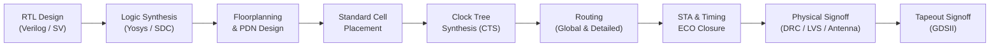

  <!-- Header Banner -->
  

  <!-- Dynamic Typing Subtitle -->
  

  <!-- Meta Badges -->
  

    
    
    
    
  

  <!-- Contact & Socials -->
  

    
    &nbsp;
    
    &nbsp;
    
  

---

### 👨‍💻 Giới thiệu (About Me)

Kỹ sư định hướng chuyên sâu vào **ASIC / IC Physical Design (Backend)** và quy trình hiện thực hóa vi mạch số từ mã nguồn RTL đến layout chế tạo silicon (**RTL-to-GDSII**).

* 🔬 **Quy trình Physical Design (RTL-to-GDSII)**: Thực thi trọn vẹn luồng thiết kế vật lý bao gồm: Floorplanning, Power Planning (PDN), Standard Cell Placement, Clock Tree Synthesis (CTS), Routing và Post-route Optimization.
* ⏱️ **Timing Closure & STA**: Thành thạo phân tích Static Timing Analysis (STA), kiểm soát đường trễ Setup/Hold, giải quyết vi phạm timing thông qua **Timing ECO** (Buffer Insertion, Cell Sizing, Pin Swapping) và quản lý ràng buộc SDC.
* ⚡ **Toàn vẹn nguồn & Vật lý (Power & Reliability)**: Xây dựng lưới phân phối nguồn (Power Ring / Stripes), phân tích sụt áp **IR-Drop**, kiểm soát điện di động (EM) và tối ưu hóa diện tích / công suất (PPA).
* 🛡️ **Kiểm tra vật lý (Physical Signoff)**: Đảm bảo thiết kế đạt chuẩn chế tạo với **100% Clean DRC & LVS**, kiểm tra Antenna rules và trích xuất tham số ký sinh (Parasitic Extraction) trên tiến trình **SkyWater 130nm PDK**.
* ⚙️ **EDA Scripting & Automation**: Thành thạo lập trình kịch bản **Tcl**, **Python** và **Bash** để tự động hóa quy trình EDA, phân tích log và trích xuất chỉ số chất lượng thiết kế (QoR / PPA).

---

### 🔄 Quy trình Triển khai ASIC Backend (RTL-to-GDSII Flow)

> 📌 **Tóm tắt quy trình:**  
> `RTL Design` ➔ `Logic Synthesis` ➔ `Floorplan & PDN` ➔ `Placement & CTS` ➔ `Routing` ➔ `STA & ECO` ➔ `DRC/LVS Verification` ➔ `GDSII Signoff`

---

### 🎯 Năng lực Kỹ thuật Cốt lõi (Core Competencies)

| Phân nhóm chuyên môn | Nội dung kỹ thuật & Trọng tâm công việc | Công cụ & Môi trường |
| :--- | :--- | :--- |
| 📐 **Physical Design & Floorplanning** | Xác định kích thước Core/Die, tỷ lệ khung (Aspect Ratio), vị trí Pin I/O, Macro Placement, Blockage/Halos, xây dựng lưới nguồn Power Distribution Network (PDN Rings & Stripes). | `OpenLane` `OpenROAD` `Magic VLSI` |
| 🚀 **Placement & Clock Tree Synthesis (CTS)** | Global & Detailed Placement, tối ưu hóa mật độ cell (Cell Density), giải tỏa nghẽn dây (Congestion), cấu trúc cây xung nhịp (Clock Inverter/Buffer Trees), cân bằng Clock Skew và hạn chế Insertion Delay. | `OpenROAD` `TritonCTS` |
| 🛣️ **Routing & DRC Closure** | Global Routing (FastRoute), Detailed Routing (TritonRoute), gán lớp kim loại (Layer Assignment), sửa lỗi Design Rule Check (DRC) và bảo vệ chân cổng tránh lỗi Antenna. | `TritonRoute` `KLayout` `Magic` |
| ⏱️ **Static Timing Analysis (STA) & ECO** | Khai báo ràng buộc thời gian (SDC), phân tích các góc hoạt động (PVT Corners), đóng vi phạm thời gian Setup/Hold bằng phương pháp Timing ECO Closure (Cell Resizing, Buffer Insertion). | `OpenSTA` `Python Automation` |
| 🔍 **Physical Verification & Signoff** | Kiểm tra quy tắc hình học (DRC), đối soát sơ đồ nguyên lý với layout (LVS), kiểm tra lỗi điện (ERC), trích xuất ký sinh SPEF (Parasitic Extraction) và xuất file GDSII chuẩn tapeout. | `Magic VLSI` `Netgen` `KLayout` |
| 🤖 **EDA Scripting & Automation** | Xây dựng script tự động hóa luồng chạy từ RTL đến GDSII, trích xuất dữ liệu timing/area từ log file, tự động hóa quy trình phân tích và báo cáo chất lượng PPA. | `Tcl / Tk` `Python` `Bash / Shell` `Linux` |

---

### 🛠️ Kỹ năng & Công cụ (Technical Stack)

#### 🔌 ASIC Physical Design & Backend

  
  
  
  
  
  

#### ⚡ EDA Tools & PDKs

  
  
  
  
  
  
  
  

#### 💻 Ngôn ngữ Lập trình & Scripting

  
  
  
  
  
  
  

---

### 🌟 Dự án IC Tiêu biểu (Featured IC Projects)

| Dự án | Mô tả Kỹ thuật & Kết quả Đạt được | Ngăn xếp Công nghệ |
| :--- | :--- | :--- |
| 🚀 [**`riscv_picorv32_sky130_asic_flow`**](https://github.com/vn-ntd/riscv_picorv32_sky130_asic_flow) | • Triển khai hoàn chỉnh luồng **RTL-to-GDSII** cho lõi vi xử lý **32-bit RISC-V (PicoRV32)**. • Đạt tần số hoạt động **133.3 MHz** với hệ số sử dụng diện tích lõi **Core Utilization ~70%**. • Đạt **100% Clean DRC, LVS & Antenna signoff** trên tiến trình **SkyWater 130nm PDK**. | `Verilog` `SkyWater 130nm` `OpenLane` `OpenROAD` `Magic` `Netgen` |
| ⏱️ [**`sta_timing_closure_eco`**](https://github.com/vn-ntd/sta_timing_closure_eco) | • Bộ công cụ và kịch bản phân tích Static Timing Analysis tự động hóa. • Tự động trích xuất slack vi phạm (Setup/Hold), đề xuất và thực hiện chèn buffer / cell sizing để đóng **Timing ECO Closure** hiệu quả. | `Python` `OpenSTA` `SDC Constraints` `EDA Automation` |
| ⚡ [**`pdn_analysis_ir_drop`**](https://github.com/vn-ntd/pdn_analysis_ir_drop) | • Mô phỏng và phân tích mạng lưới cấp nguồn (Power Distribution Network). • Đánh giá sụt áp tĩnh (Static IR-Drop), phát hiện các điểm nghẽn nguồn (hotspots) và tối ưu hóa mật độ thanh dẫn nguồn. | `Python` `PDN Modeling` `IR-Drop Analysis` |
| 🧰 [**`pd_flow_toolkit`**](https://github.com/vn-ntd/pd_flow_toolkit) | • Bộ công cụ script chuyên dụng cho kỹ sư Physical Design. • Tự động parse file log từ các công cụ EDA, trích xuất báo cáo chất lượng PPA (Power, Performance, Area) và tạo biểu đồ trực quan. | `Tcl` `Python` `Bash` `CI/CD for EDA` |

---

### 📊 Thống kê Hoạt động (GitHub Analytics)

  
  &nbsp;
  

  

---

  💡 <i>"From RTL Architecture to Silicon Signoff — Engineering Resilient, High-Performance Physical Design Solutions."</i>
    
  © 2026 <b>Nguyen Tien Dung (vn-ntd)</b> • IC Physical Design

